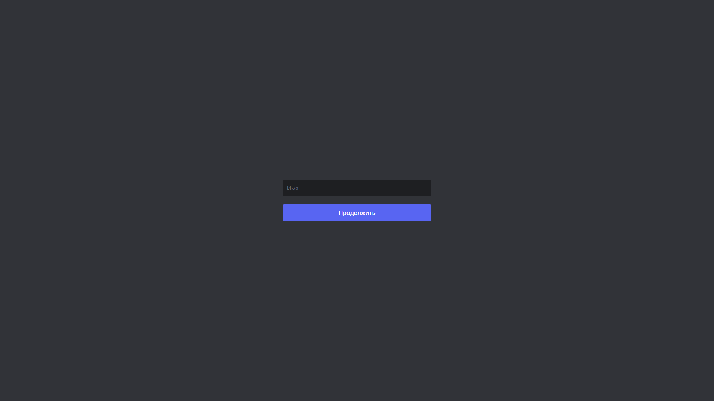
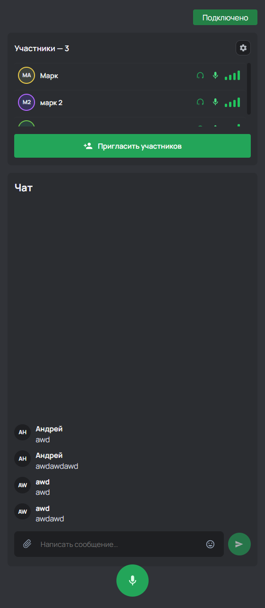
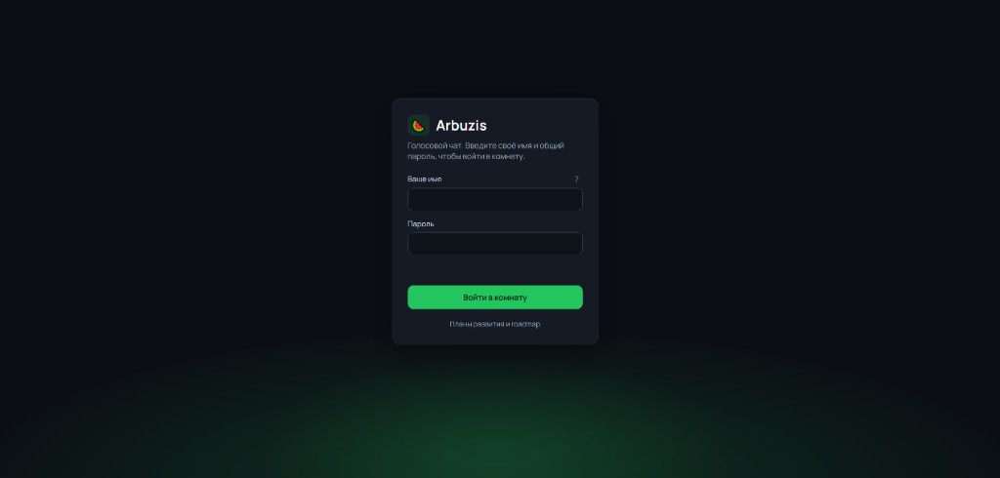
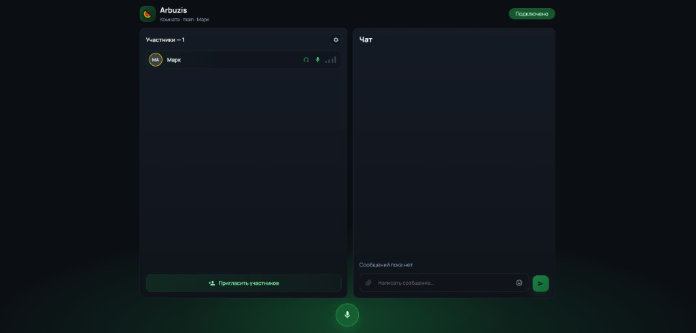

# Arbuzis Voice Chat

Простой веб-сервис для голосового общения в одной комнате. Пользователь заходит на сайт, вводит имя и общий пароль, попадает в комнату и общается голосом и текстом.

## Версия 2.1

**v2.1.0** — вход в два шага, тёмная комната и картинки в чате. Скриншот никуда не сохраняется: его видят только те, кто уже в комнате.

### Скриншоты

#### Первая страница



#### Комната



### Что добавлено в 2.1

**Вход**

- Два шага на одном экране: сначала имя и «Продолжить», затем пароль и «Войти в комнату»
- Только поле и кнопка, без карточки, заголовка и лишних подписей
- Ошибка появляется над формой и только когда она есть

**Комната**

- Тёмное оформление
- Свои сообщения — зелёные плашки с аватаром, временем и удалением
- Чужие сообщения — имя рядом с аватаром, текст под именем
- Кнопки «Пригласить участников» и отправки зелёные
- Кнопка отправки справа от поля и на одной линии с ним
- Обводка поля чата при фокусе серая
- Скролл списка участников оформлен так же, как скролл чата

**Картинки в чате**

- Скрепка с подсказкой «Прикрепить файл»
- png, jpeg, webp и gif до 15 МБ
- Вставка скриншота из буфера через Ctrl+V, когда курсор в поле чата
- Файл не пишется на сервер и не хранится на диске
- Картинку видят только участники, которые уже в комнате

## Стабильная версия 2.0.0

**v2.0.0** — первая мажорная отсечка: полноценная комната с голосом, текстовым чатом, настройками и индикаторами качества связи. Версия проверена в production на VPS.

### Скриншоты

#### Вход



#### Комната



### Что входит в 2.0.0

**Голос**

- WebRTC через LiveKit, одна общая комната (до 5 участников)
- Включение / выключение микрофона
- Шумоподавление DTLN (beta), настройка в боковой панели
- Регулировка громкости входящего звука — общая и по каждому участнику (наушники + ползунок)
- Подсветка говорящего участника
- Звуки интерфейса — микрофон вкл/выкл, вход участника (можно отключить)
- Автопереподключение после блокировки экрана и возврата на вкладку
- Wake Lock — экран не гаснет во время разговора

**Участники**

- Список с аватарами, цветами и уникальными именами
- Индикатор качества соединения (полоски сигнала) у каждого участника
- Приглашение по ссылке (копирование в буфер)
- Настройки комнаты — шумоподавление, звуки UI

**Чат**

- Текстовые сообщения между участниками
- Смайлики, удаление своих сообщений
- Поле ввода на всю ширину панели

**Интерфейс**

- Тёмная тема, русский язык
- Понятные сообщения об ошибках
- Страница `/roadmap` с планами развития
- Кнопка «Подключено» → «Отключиться» без сдвига вёрстки

Подробнее о будущих фичах: [ROADMAP.md](ROADMAP.md).

## Стек

| Часть        | Технология                   |
| ------------ | ---------------------------- |
| Frontend     | Angular 21                   |
| Backend API  | Express + LiveKit Server SDK |
| Медиа-сервер | LiveKit (Docker)             |

## Требования

- [Node.js](https://nodejs.org/) 20+
- [Docker](https://www.docker.com/) (для LiveKit)
- npm

## Быстрый старт

### 1. Клонировать репозиторий

```bash
git clone https://github.com/MarkAloha/voice-chat-arbuzis.git
cd voice-chat-arbuzis
```

### 2. Установить зависимости

```bash
npm install
```

### 3. Настроить переменные окружения

Скопируйте пример и отредактируйте пароль:

```bash
cp .env.example .env
```

Основные переменные в `.env`:

| Переменная           | Описание                                                                 |
| -------------------- | ------------------------------------------------------------------------ |
| `SITE_PASSWORD`      | Общий пароль для входа на сайт                                           |
| `LIVEKIT_API_KEY`    | API-ключ LiveKit (должен совпадать с docker-compose)                     |
| `LIVEKIT_API_SECRET` | Секрет LiveKit (должен совпадать с docker-compose)                       |
| `LIVEKIT_URL`        | Адрес LiveKit WebSocket (`ws://localhost:7880` для локальной разработки) |
| `ROOM_NAME`          | Имя единственной комнаты (по умолчанию `main`)                           |

### 4. Запустить LiveKit

В **первом терминале**:

```bash
npm run livekit
```

Дождитесь строки `starting LiveKit server`. Проверить, что контейнер работает:

```bash
docker compose ps
```

Статус должен быть **Up**.

### 5. Запустить приложение

Во **втором терминале**:

```bash
npm run dev
```

Команда поднимает:

- API-сервер на `http://localhost:3000`
- Angular-приложение на `http://localhost:4200`

### 6. Открыть в браузере

Перейдите на [http://localhost:4200](http://localhost:4200), введите имя, затем пароль из `.env`.

Для проверки откройте второй браузер или вкладку в режиме инкognito с другим именем.

## Команды

| Команда           | Описание                                                   |
| ----------------- | ---------------------------------------------------------- |
| `npm run livekit` | Запустить LiveKit в Docker                                 |
| `npm run dev`     | Запустить API + фронтенд (основная команда для разработки) |
| `npm run api`     | Только API-сервер (порт 3000)                              |
| `npm start`       | Только Angular (порт 4200, нужен отдельно запущенный API)  |
| `npm run build`   | Сборка production                                          |
| `npm test`        | Запуск тестов                                              |

## Структура проекта

```text
voice-chat-arbuzis/
├── docs/
│   ├── screenshots/        # Скриншоты для README
│   └── design/             # Макеты UI
├── src/
│   ├── app/
│   │   ├── models/         # Интерфейсы домена (join, chat, participant)
│   │   ├── pages/login/    # Экран входа (имя, затем пароль)
│   │   ├── pages/room/     # Голосовая комната
│   │   ├── pages/roadmap/  # Публичный roadmap
│   │   ├── services/       # LiveKit, API, сессия, звуки
│   │   └── guards/         # Защита маршрута комнаты
│   └── api/                # Backend: проверка пароля, выдача токена
├── dev-api.ts              # Dev-сервер API
├── docker-compose.yml      # LiveKit
├── load-env.ts             # Загрузка .env
└── .env.example            # Пример настроек
```

## Как это работает

1. Пользователь вводит имя, затем пароль на `/login`.
2. API проверяет пароль и выдаёт JWT-токен для LiveKit.
3. Браузер подключается к LiveKit и публикует аудио с микрофона.
4. Список участников и чат обновляются через события LiveKit Room.

Сессия хранится только в памяти браузера — после обновления страницы (F5) или закрытия вкладки нужно войти заново.

## Деплой на VPS (production)

### Требования

- Ubuntu VPS с Docker и Docker Compose
- Домен с A-записью на IP сервера (например DuckDNS)
- Открытые порты: 80, 443, 7881/tcp, 50000–50100/udp

### 1. DNS

Настройте A-запись:

```text
ваш-домен.example.com  →  IP_вашего_VPS
```

### 2. Firewall на VPS

```bash
sudo ufw allow 22/tcp
sudo ufw allow 80/tcp
sudo ufw allow 443/tcp
sudo ufw allow 7881/tcp
sudo ufw allow 50000:50100/udp
sudo ufw enable
```

### 3. Клонировать и настроить

```bash
git clone https://github.com/MarkAloha/voice-chat-arbuzis.git
cd voice-chat-arbuzis
cp .env.production.example .env
nano .env
```

Обязательно измените в `.env`:

- `SITE_PASSWORD` — пароль для входа
- `LIVEKIT_API_SECRET` — длинный случайный секрет
- `LIVEKIT_NODE_IP` — публичный IP VPS

### 4. Запуск

```bash
docker compose -f docker-compose.prod.yml up -d --build
```

### 5. Проверка

```bash
docker compose -f docker-compose.prod.yml ps
docker compose -f docker-compose.prod.yml logs -f
```

Откройте https://voice-chat-arbuzis.duckdns.org

### 6. Обновление

```bash
git pull
docker compose -f docker-compose.prod.yml up -d --build
```

## Сборка production (локально)

```bash
npm run build
npm run serve:ssr:voice-chat-arbuzis
```

## Частые проблемы

### «Не удалось установить сигнальное соединение»

LiveKit не запущен или контейнер упал. Проверьте:

```bash
docker compose ps
docker compose logs --tail 20
```

Перезапустите:

```bash
npm run livekit
```

### Пароль из `.env` не меняется

Перезапустите `npm run dev` (или `npm run api`). Пароль проверяет API-сервер на порту 3000, а не Angular.

### Микрофон не работает

В браузере нужен HTTPS (или `localhost` для локальной разработки). На VPS без домена и HTTPS микрофон блокируется.

## Лицензия

Private
